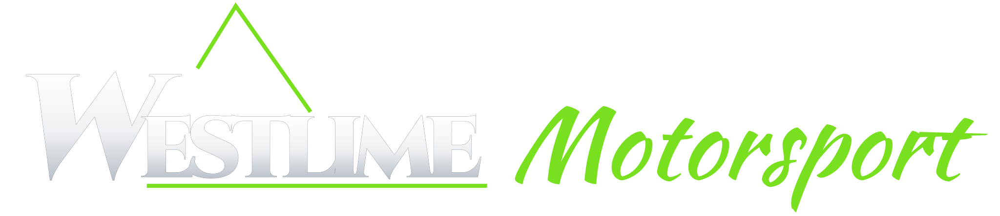

# GoPro Split Screen



Watch two GoPro live feeds side by side, e.g. two cameras on a race truck streaming over Starlink. It runs in any browser (phone, tablet, laptop, TV), so the crew can watch from the pits or from home.

## Using it

1. Open the app and paste one camera's stream link into each half. It accepts:
   - **YouTube Live** links (`youtube.com/live/…`, `youtu.be/…`, `watch?v=…`) or a channel link (`youtube.com/channel/UC…`) to show whatever that channel has live
   - **Twitch** channels (`twitch.tv/name`)
   - **HLS** links ending in `.m3u8`
   - **WebRTC (WHEP)** links from your own stream server, e.g. MediaMTX `https://server:8889/truck1` or Cloudflare Stream `…/webRTC/play`
2. Optionally fill in the **car number**, **driver** and **navigator**. They show on that feed as a caption in Westlime green, like on TV. You can also name the camera (e.g. "Bonnet cam").
3. If a camera is mounted upside down or sideways, set **Picture** to *Upside down* (or a quarter turn), or tap the **rotate** button on the feed. Each tap turns it 90° clockwise.
4. Tap **Share**, give the broadcast a title (e.g. "KDR 2026 · Truck 12") and tap **Copy link** (or **Send…** on a phone) to text or email it.

Whoever opens the watch link goes straight to both cameras, with the title at the top, and each feed keeps its car number, crew names and rotation. They can't see setup forms or change your cameras, and nothing they do changes your own setup. YouTube links are shortened to their video ID, so the link stays short enough to text. Your own screen remembers your setup, and its address works as an edit link for you.

Other controls:
- **Layout**: *Auto* puts the cameras side by side in landscape and one above the other in portrait. You can also fix it to *Side by side* or *Stacked*.
- **Swap**: switches the two cameras round without dropping either feed.
- **Full screen** (where the browser supports it).
- Sound starts muted. **Sound on** plays one camera at a time. YouTube and Twitch use their own speaker button.

A dropped feed reconnects by itself. The dot next to each camera is green when live, amber while waiting or reconnecting, and red for a problem. The screen stays on while you're watching.

## Getting the GoPros streaming over Starlink

Each GoPro joins the Starlink Wi-Fi (or a travel router connected to it) and pushes a live stream out over RTMP. Because the cameras send the stream out, nothing needs opening up on Starlink's side.

### Easiest: YouTube Live (free, about 5–10 s behind)

1. In **YouTube Studio → Create → Go live → Stream**, set up one stream per camera, each with its **own stream key**. Set them to **Unlisted** and **Ultra-low latency**. Turn **Auto-stop off**, so that a Starlink dropout doesn't end the broadcast and change its link.
2. In the **GoPro Quik** app, connect to the first camera and start a livestream using **RTMP**, on the Starlink Wi-Fi, with the URL `rtmp://a.rtmp.youtube.com/live2/<stream key>`. Once it's live, connect to the second camera and do the same with the other key. The cameras keep streaming without the phone.
3. Copy each stream's link (**Share → Copy link**) and paste one into each half of the app.

### Least delay: your own stream server (about 1 s behind)

Run [MediaMTX](https://github.com/bluenviron/mediamtx) on a small cloud server and give it an https address (browsers won't play `http://` streams in an `https://` page). Point the cameras at `rtmp://your-server/truck1` and `rtmp://your-server/truck2`. Then paste `https://your-server:8889/truck1` and `…/truck2` into the app (WebRTC), or `https://your-server:8888/truck1/index.m3u8` (HLS, a few seconds more delay).

### Tips

- Both cameras share Starlink's upload. If either feed keeps buffering, set the cameras to **720p**.
- Using Starlink while driving needs a dish and plan that support in-motion use.

## Hosting

It's a static site with no build step. On GitHub, go to *Settings → Pages* and set *Source* to **GitHub Actions**. Each push to `main` then runs the tests and deploys to `https://<user>.github.io/livestream/`.

To run it on your own computer: `npm start`, then open `http://localhost:8080`.

## Development

```
npm test    # unit tests for link parsing and watch links (Node 20+)
```

- `js/sources.js`: works out what a pasted link is and how to play it, and builds watch links (no DOM, runs in Node)
- `js/players.js`: YouTube/Twitch embeds, HLS and WebRTC (WHEP) players with automatic reconnect
- `js/app.js`: the split screen, setup forms, layout, sound and share link
- `assets/westlime-logo-wide.svg`: Westlime Motorsport logo, from the Race Course Plotter (lettering converted to outlines from Cinzel and Kaushan Script, both SIL Open Font License)
- `vendor/hls.light.min.js`: [hls.js](https://github.com/video-dev/hls.js) 1.7.3 (Apache 2.0, see `vendor/hls.js-LICENSE`) for HLS in browsers other than Safari
